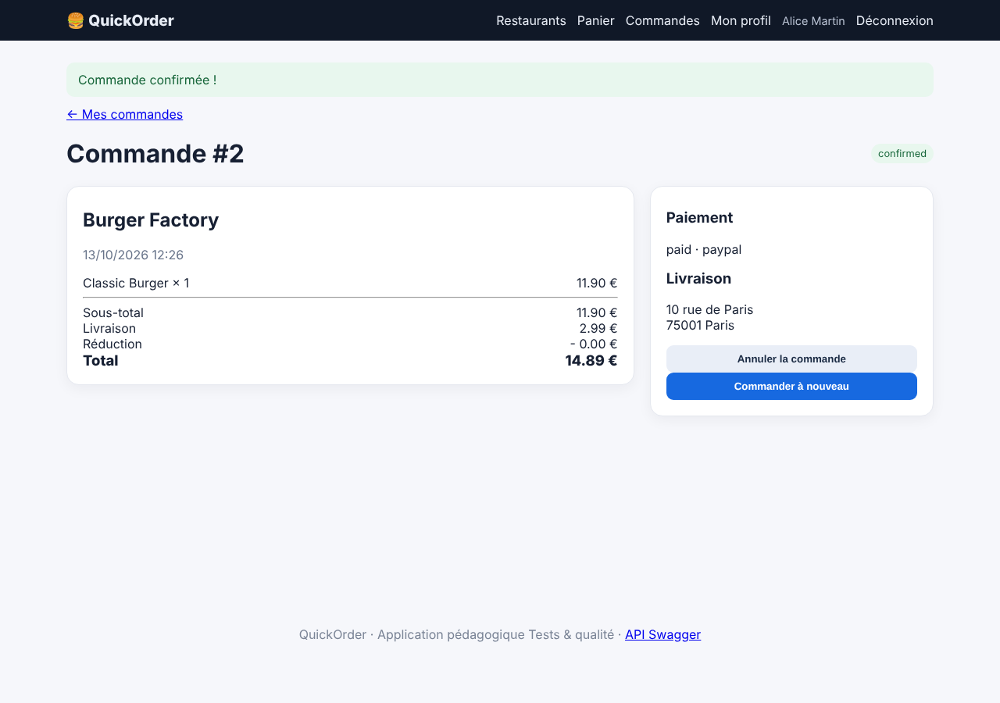
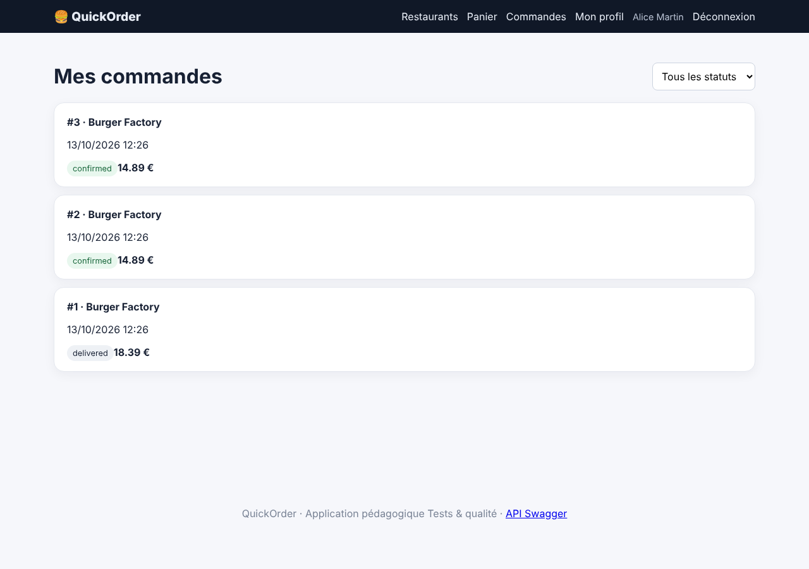

# BUG-001 — Le paiement PayPal crée deux commandes identiques (web et API)

| Champ | Valeur |
|---|---|
| Sévérité | **Critique** |
| Priorité | **P1** |
| Canal | UI + API |
| Module | Paiement / Commande |
| Statut | Ouvert |
| Détecté le | 13/10/2026 |
| Détecté par | Quality audit |
| Cas de test liés | TC-RM-04 |
| Environnement | QuickOrder V3.1 · base initialisée par `python seed.py` · http://127.0.0.1:5000 · Chromium (Playwright) · Python 3.13 · SQLite |

## Contexte

Parcours critique « acheter ». Le mode PayPal est proposé au checkout et dans `POST /api/orders`. Un seul clic sur « Confirmer » doit créer une seule commande.

## Préconditions

Base initialisée (`python seed.py`) : Alice n'a qu'une commande (#1) et le Classic Burger a un stock de 100. Alice est connectée (alice@example.com / Password123!).

## Étapes pour reproduire

1. Ouvrir le menu de Burger Factory (/restaurant/1) et cliquer sur « Ajouter » pour le Classic Burger (quantité 1).
2. Ouvrir /checkout et choisir « PayPal — succès » comme mode de paiement.
3. Cliquer une seule fois sur « Confirmer 14.89 € ».
4. Ouvrir /orders et compter les commandes, puis relire le stock du Classic Burger sur /restaurant/1.

## Résultat attendu

Une seule commande est créée et débitée une fois ; le stock du Classic Burger passe de 100 à 99.

## Résultat obtenu

Deux commandes distinctes et identiques (#2 et #3, 14,89 € chacune) apparaissent dans « Mes commandes » ; l'utilisateur est redirigé vers la première seulement. Le stock passe de 100 à 98. Le même comportement existe via l'API (`POST /api/orders` avec `payment_method: paypal`).

## Preuves

**Rejouer en ligne de commande (API) (commande de rejeu)**

```bash
curl -s -H 'X-API-Key: quickorder-demo-key' -H 'Content-Type: application/json' -d '{"items":[{"product_id":1,"quantity":1}],"payment_method":"paypal"}' http://127.0.0.1:5000/api/orders
curl -s -H 'X-API-Key: quickorder-demo-key' http://127.0.0.1:5000/api/orders | python3 -c 'import sys,json; print(json.load(sys.stdin)["count"])'
```

### Preuves du cas TC-RM-04 (Fail)





Vidéo : [TC-RM-04_paypal_double_commande.webm](../evidence/TC-RM-04_paypal_double_commande.webm)

Trace `TC-RM-04.txt` :

```text
Commandes avant : [1] ; après : [3, 2, 1]
```

### Rejeu automatique (curl)

Le script `docs/automation/reproduce_bugs.sh` rejoue ce bug et affiche `REPRODUIT` ou `NON REPRODUIT` ; sortie conservée dans [`reproduction-curl.txt`](../evidence/reproduction-curl.txt).

## Analyse

- **Cause probable** : app/routes/orders.py : le bloc `if payment == "paypal"` appelle une seconde fois `build_order` et `add_order_items` ; même schéma dans app/routes/api.py (« PayPal duplicates the order »).
- **Impact** : Double facturation potentielle, double décrément du stock, litiges : atteint directement le chiffre d'affaires et la confiance.

## Suggestion de correction

Supprimer le second appel, rendre la création de commande idempotente (clé d'idempotence par paiement) et ajouter un test de non-régression.
