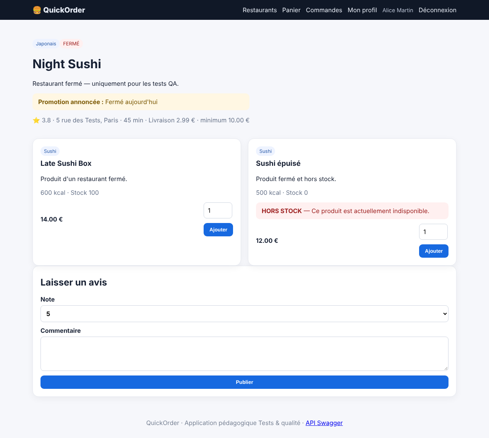
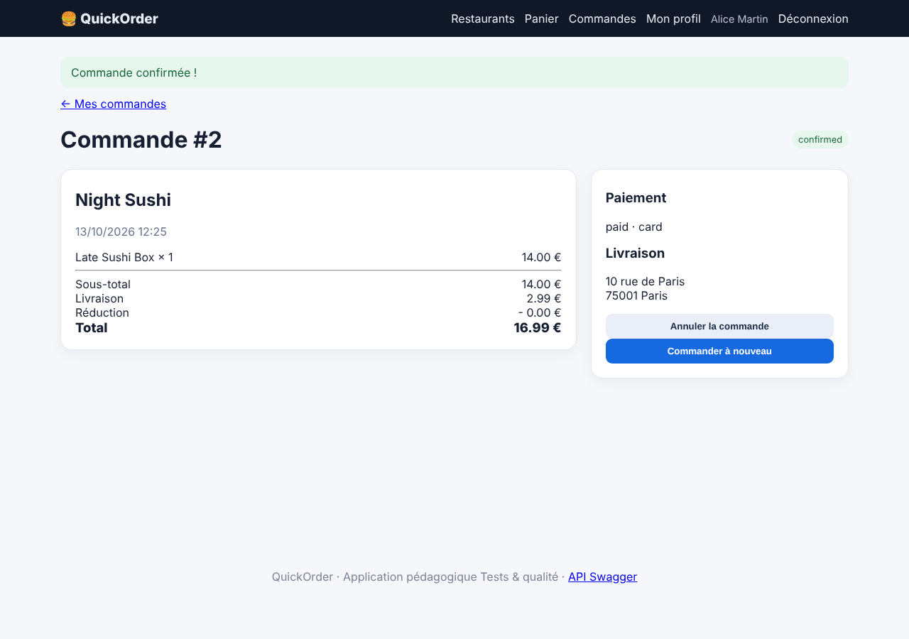

# BUG-002 — Un restaurant fermé peut recevoir des commandes (web et API)

| Champ | Valeur |
|---|---|
| Sévérité | **Majeure** |
| Priorité | **P1** |
| Canal | UI + API |
| Module | Commande |
| Statut | Ouvert |
| Détecté le | 13/10/2026 |
| Détecté par | Quality audit |
| Cas de test liés | TC-RM-01 |
| Environnement | QuickOrder V3.1 · base initialisée par `python seed.py` · http://127.0.0.1:5000 · Chromium (Playwright) · Python 3.13 · SQLite |

## Contexte

Night Sushi est affiché avec le badge FERMÉ, mais ses produits restent commandables.

## Préconditions

Base initialisée ; Alice connectée ; panier vide. Night Sushi (id 6) est fermé ; Late Sushi Box (id 24) coûte 14,00 €.

## Étapes pour reproduire

1. Ouvrir /restaurant/6 : le badge FERMÉ est visible.
2. Cliquer sur « Ajouter » pour Late Sushi Box.
3. Ouvrir /checkout, choisir « Carte bancaire » et cliquer sur « Confirmer ».

## Résultat attendu

L'ajout ou, au plus tard, la confirmation est refusé avec un message « restaurant fermé ».

## Résultat obtenu

Le produit est ajouté et la commande est confirmée (statut `confirmed`, paiement `paid`) chez le restaurant fermé. Via l'API, `POST /api/orders` sur le produit 24 renvoie 201 au lieu de 409.

## Preuves

**Rejouer en ligne de commande (API) (commande de rejeu)**

```bash
curl -s -o /dev/null -w '%{http_code}\n' -X POST -H 'X-API-Key: quickorder-demo-key' -H 'Content-Type: application/json' -d '{"items":[{"product_id":24,"quantity":1}],"payment_method":"card"}' http://127.0.0.1:5000/api/orders
```

### Preuves du cas TC-RM-01 (Fail)





Trace `TC-RM-01.txt` :

```text
Flashs ajout : ['Late Sushi Box ajouté au panier.', "Promotion annoncée : Fermé aujourd'hui", 'HORS STOCK — Ce produit est actuellement indisponible.'] ; URL finale : htt
```

### Rejeu automatique (curl)

Le script `docs/automation/reproduce_bugs.sh` rejoue ce bug et affiche `REPRODUIT` ou `NON REPRODUIT` ; sortie conservée dans [`reproduction-curl.txt`](../evidence/reproduction-curl.txt).

## Analyse

- **Cause probable** : Aucun contrôle de `restaurant.is_open` dans app/routes/shop.py (ajout au panier), app/routes/orders.py (checkout) ni app/routes/api.py (création de commande).
- **Impact** : Commandes impossibles à honorer, clients mécontents, remboursements.

## Suggestion de correction

Contrôler `is_open` à l'ajout, à la validation du checkout et dans l'API (409 avec message explicite) ; désactiver « Ajouter » sur les restaurants fermés.
