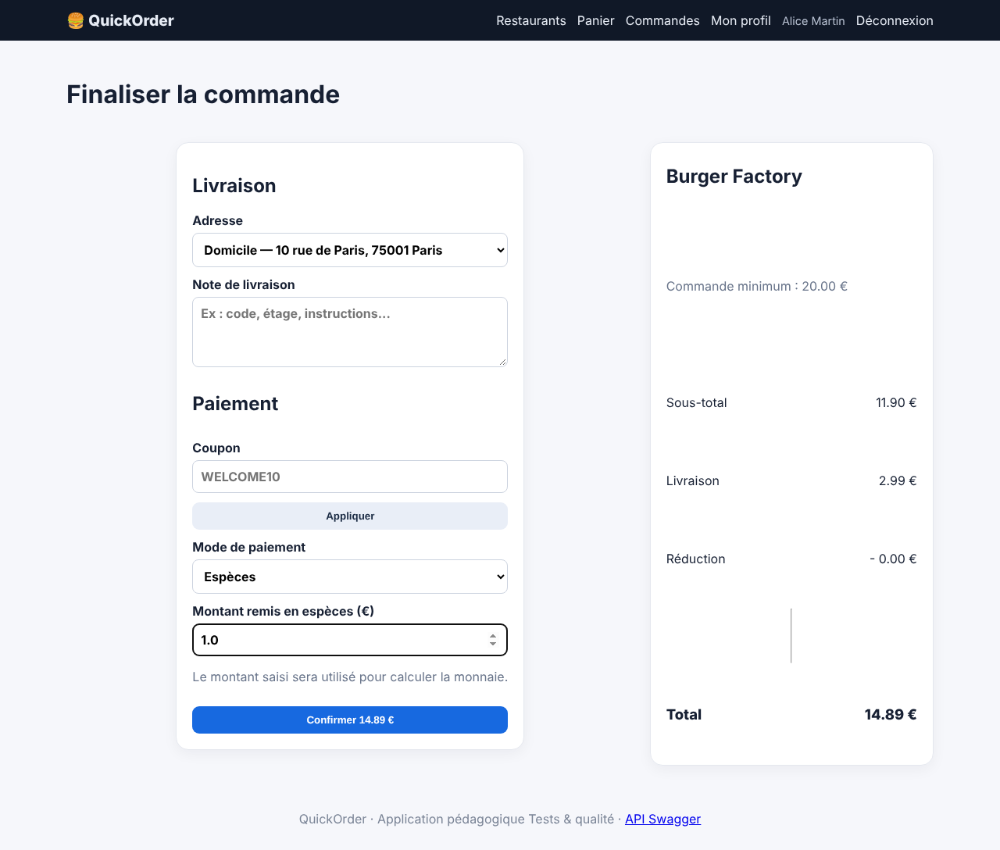
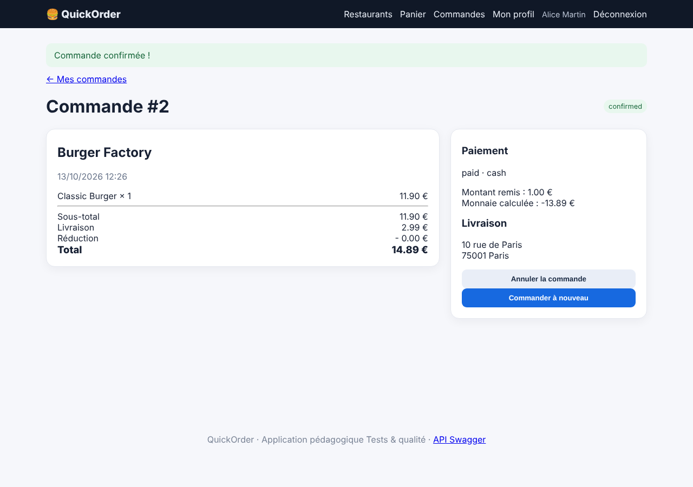

# BUG-003 — Le paiement en espèces accepte un montant inférieur au total (monnaie négative)

| Champ | Valeur |
|---|---|
| Sévérité | **Majeure** |
| Priorité | **P1** |
| Canal | UI + API |
| Module | Paiement |
| Statut | Ouvert |
| Détecté le | 13/10/2026 |
| Détecté par | Quality audit |
| Cas de test liés | TC-RM-03 |
| Environnement | QuickOrder V3.1 · base initialisée par `python seed.py` · http://127.0.0.1:5000 · Chromium (Playwright) · Python 3.13 · SQLite |

## Contexte

Avec « Espèces », le client indique le montant remis pour calculer la monnaie à rendre.

## Préconditions

Base initialisée ; Alice connectée ; panier : 1 × Classic Burger (total 14,89 € avec la livraison).

## Étapes pour reproduire

1. Ouvrir /checkout et choisir « Espèces ».
2. Saisir 1,00 dans « Montant remis ».
3. Cliquer sur « Confirmer » puis lire le détail de la commande.
4. Recommencer avec un panier neuf en laissant le montant vide.

## Résultat attendu

La commande est refusée : le montant remis doit être supérieur ou égal au total (14,89 €).

## Résultat obtenu

La commande est confirmée et payée. Le détail affiche « Montant remis : 1.00 € » et « Monnaie calculée : -13.89 € ». Un montant vide (0,00 €) est lui aussi accepté.

## Preuves

**Rejouer en ligne de commande (API) (commande de rejeu)**

```bash
curl -s -X POST -H 'X-API-Key: quickorder-demo-key' -H 'Content-Type: application/json' -d '{"items":[{"product_id":1,"quantity":1}],"payment_method":"cash","cash_received":1}' http://127.0.0.1:5000/api/orders
```

### Preuves du cas TC-RM-03 (Fail)






Trace `TC-RM-03.txt` (extrait) :

```text
Commande confirmée !
← Mes commandes
Commande #2
confirmed
Burger Factory

13/10/2026 12:26

Classic Burger × 1
11.90 €
Sous-total
11.90 €
Livraison
2.99 €
Réduction
- 0.00 €
Total
14.89 €
Paiement

paid · cash

Montant remis : 1.00 €
Monnaie calculée : -13.89 €

Livraison

10 rue de Paris
75001 Paris

Annuler la commande
Commander à nouveau
Cas « montant remis vide » :
Commande confirmée !
```

### Rejeu automatique (curl)

Le script `docs/automation/reproduce_bugs.sh` rejoue ce bug et affiche `REPRODUIT` ou `NON REPRODUIT` ; sortie conservée dans [`reproduction-curl.txt`](../evidence/reproduction-curl.txt).

## Analyse

- **Cause probable** : app/routes/orders.py (`build_order`) et app/routes/api.py calculent `change_due = cash_received - total` sans jamais comparer les deux montants.
- **Impact** : Perte financière à la livraison et données de paiement fausses.

## Suggestion de correction

Refuser `cash_received < total` côté serveur (400 avec message), rendre le champ obligatoire pour « Espèces ».
