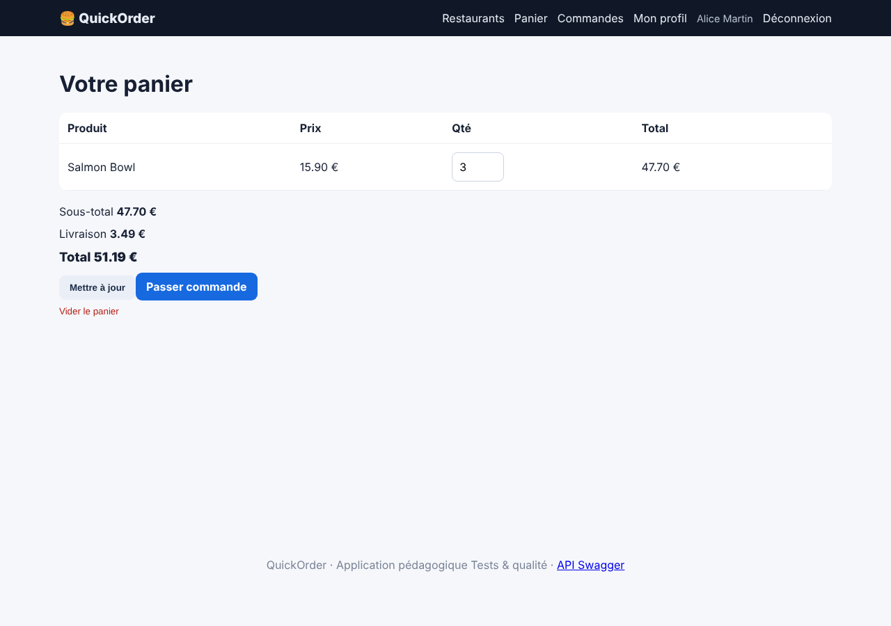
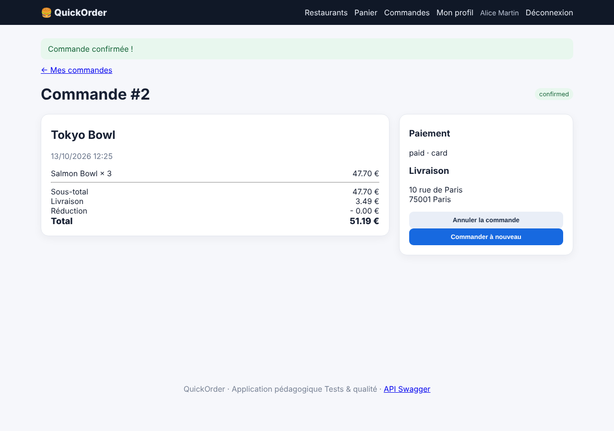
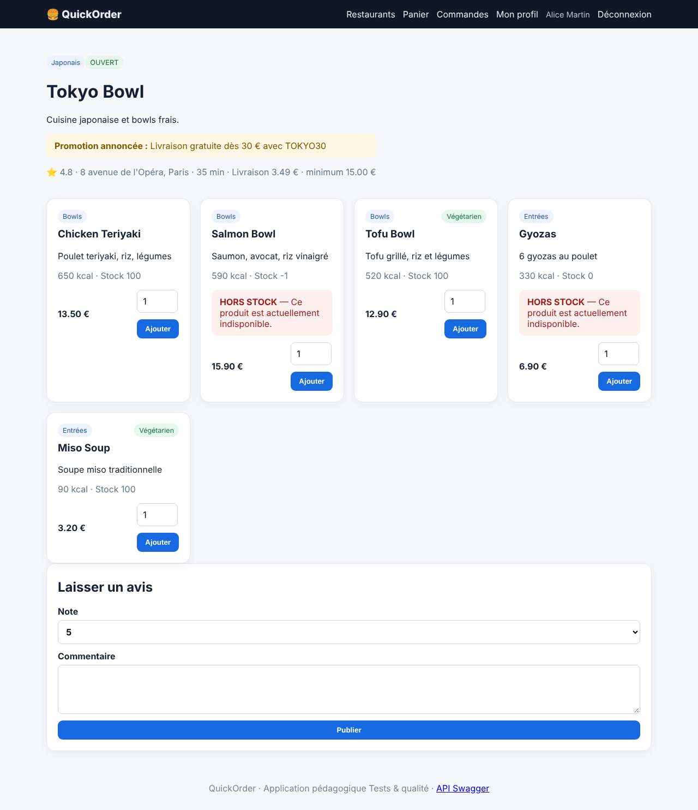

# BUG-004 — Contrôles de stock défaillants : quantité supérieure au stock et produit en rupture commandables

| Champ | Valeur |
|---|---|
| Sévérité | **Majeure** |
| Priorité | **P1** |
| Canal | UI + API |
| Module | Stock / Panier |
| Statut | Ouvert |
| Détecté le | 13/10/2026 |
| Détecté par | Quality audit |
| Cas de test liés | TC-LIM-06 |
| Environnement | QuickOrder V3.1 · base initialisée par `python seed.py` · http://127.0.0.1:5000 · Chromium (Playwright) · Python 3.13 · SQLite |

## Contexte

Le menu affiche « Stock N » et un bandeau HORS STOCK, mais la règle n'est pas appliquée à la commande.

## Préconditions

Base initialisée ; Alice connectée. Salmon Bowl (id 7, Tokyo Bowl) a un stock de 2 ; Veggie Burger (id 4) un stock de 0.

## Étapes pour reproduire

1. Ouvrir /restaurant/2 (Tokyo Bowl). Dans les outils de développement, retirer l'attribut `max` du champ quantité du Salmon Bowl.
2. Saisir 3 et cliquer sur « Ajouter » : le produit entre dans le panier.
3. Ouvrir /checkout, choisir « Carte bancaire » et confirmer.
4. Rouvrir /restaurant/2 et lire le stock du Salmon Bowl.
5. Variante API : commander le Veggie Burger (stock 0) avec `POST /api/orders`.

## Résultat attendu

Une quantité supérieure au stock est refusée, un produit à stock 0 ne peut pas être commandé, le stock n'est jamais négatif.

## Résultat obtenu

3 Salmon Bowl sont commandés pour un stock de 2 (sous-total 47,70 €, commande confirmée) et le stock affiché devient −1. Via l'API, 3 × Salmon Bowl et 1 × Veggie Burger (stock 0) renvoient 201 au lieu de 409.

## Preuves

**Rejouer en ligne de commande (API) (commande de rejeu)**

```bash
curl -s -o /dev/null -w '%{http_code}\n' -X POST -H 'X-API-Key: quickorder-demo-key' -H 'Content-Type: application/json' -d '{"items":[{"product_id":7,"quantity":3}],"payment_method":"card"}' http://127.0.0.1:5000/api/orders
curl -s -H 'X-API-Key: quickorder-demo-key' http://127.0.0.1:5000/api/products/7 | python3 -c 'import sys,json; print(json.load(sys.stdin)["stock"])'
curl -s -o /dev/null -w '%{http_code}\n' -X POST -H 'X-API-Key: quickorder-demo-key' -H 'Content-Type: application/json' -d '{"items":[{"product_id":4,"quantity":1}],"payment_method":"card"}' http://127.0.0.1:5000/api/orders
```

### Preuves du cas TC-LIM-06 (Fail)







Trace `TC-LIM-06.txt` :

```text
Stock 2, flashs ['Salmon Bowl ajouté au panier.', 'Promotion annoncée : Livraison gratuite dès 30 € avec TOKYO30', 'HORS STOCK — Ce produit est actuellement indisponible.
Commande #2 confirmée (confirmed) ; stock du Salmon Bowl : 2 → -1
```

### Rejeu automatique (curl)

Le script `docs/automation/reproduce_bugs.sh` rejoue ce bug et affiche `REPRODUIT` ou `NON REPRODUIT` ; sortie conservée dans [`reproduction-curl.txt`](../evidence/reproduction-curl.txt).

## Analyse

- **Cause probable** : app/routes/orders.py (`add_order_items` : `product.stock -= quantity` sans test), app/routes/shop.py (ajout au panier sans contrôle du stock), app/routes/api.py (« forgets the stock quantity »).
- **Impact** : Survente, commandes impossibles à livrer, stock incohérent.

## Suggestion de correction

Centraliser la règle : refuser si `quantité > stock` et décrémenter par une mise à jour atomique (`UPDATE … WHERE stock >= :q`).
