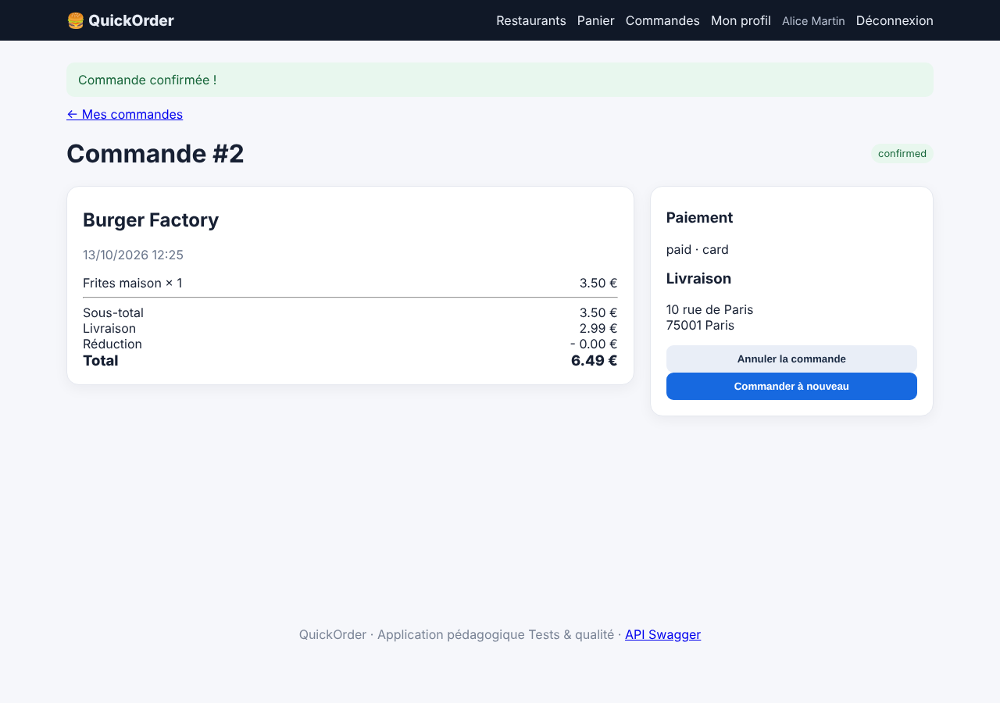

# BUG-005 — Le minimum de commande du restaurant n'est pas appliqué (web et API)

| Champ | Valeur |
|---|---|
| Sévérité | **Majeure** |
| Priorité | **P2** |
| Canal | UI + API |
| Module | Commande |
| Statut | Ouvert |
| Détecté le | 13/10/2026 |
| Détecté par | Quality audit |
| Cas de test liés | TC-RM-02 |
| Environnement | QuickOrder V3.1 · base initialisée par `python seed.py` · http://127.0.0.1:5000 · Chromium (Playwright) · Python 3.13 · SQLite |

## Contexte

Chaque restaurant affiche « minimum X € » (Burger Factory : 20,00 €).

## Préconditions

Base initialisée ; Alice connectée ; panier vide.

## Étapes pour reproduire

1. Ouvrir /restaurant/1 et ajouter 1 × Frites maison (3,50 €).
2. Ouvrir /checkout, choisir « Carte bancaire » et confirmer.

## Résultat attendu

La commande est refusée avec un message « minimum de commande de 20,00 € non atteint ».

## Résultat obtenu

La commande est confirmée pour 3,50 € de produits (6,49 € livraison comprise). Même résultat via l'API (201).

## Preuves

**Rejouer en ligne de commande (API) (commande de rejeu)**

```bash
curl -s -o /dev/null -w '%{http_code}\n' -X POST -H 'X-API-Key: quickorder-demo-key' -H 'Content-Type: application/json' -d '{"items":[{"product_id":3,"quantity":1}],"payment_method":"card"}' http://127.0.0.1:5000/api/orders
```

### Preuves du cas TC-RM-02 (Fail)



### Rejeu automatique (curl)

Le script `docs/automation/reproduce_bugs.sh` rejoue ce bug et affiche `REPRODUIT` ou `NON REPRODUIT` ; sortie conservée dans [`reproduction-curl.txt`](../evidence/reproduction-curl.txt).

## Analyse

- **Cause probable** : Le champ `minimum_order` est affiché mais jamais lu dans app/routes/orders.py ni dans app/routes/api.py.
- **Impact** : Livraisons non rentables et règle commerciale trompeuse.

## Suggestion de correction

Comparer le sous-total au minimum du restaurant au checkout et dans l'API (400/409 avec le montant manquant).
