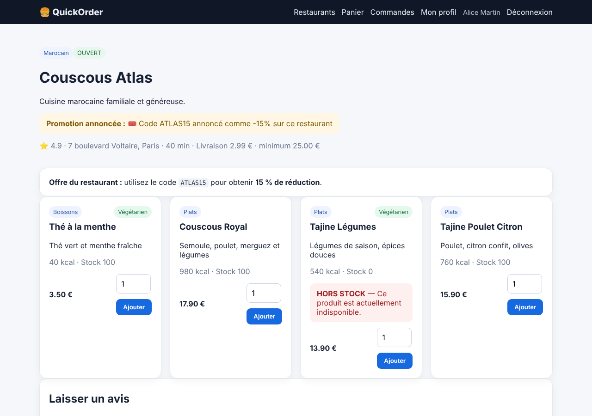
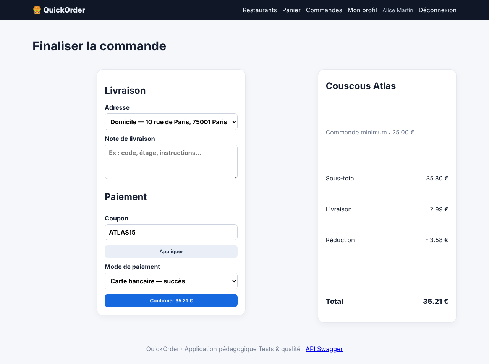

# BUG-006 — ATLAS15 est annoncé à 15 % mais appliqué à 10 %

| Champ | Valeur |
|---|---|
| Sévérité | **Majeure** |
| Priorité | **P2** |
| Canal | UI + API |
| Module | Coupons |
| Statut | Ouvert |
| Détecté le | 13/10/2026 |
| Détecté par | Quality audit |
| Cas de test liés | TC-RM-05 |
| Environnement | QuickOrder V3.1 · base initialisée par `python seed.py` · http://127.0.0.1:5000 · Chromium (Playwright) · Python 3.13 · SQLite |

## Contexte

La fiche Couscous Atlas annonce « code ATLAS15 : 15 % de réduction ».

## Préconditions

Base initialisée ; Alice connectée ; panier : 2 × Couscous Royal (35,80 €, minimum du restaurant 25 €).

## Étapes pour reproduire

1. Ouvrir /restaurant/5 et lire l'offre annoncée.
2. Ouvrir /checkout, saisir ATLAS15 dans « Coupon » et cliquer sur « Appliquer ».
3. Lire le récapitulatif (réduction et total).

## Résultat attendu

Réduction de 5,37 € (15 % de 35,80 €) et total de 33,42 €.

## Résultat obtenu

Réduction de 3,58 € (10 %) et total de 35,21 €, soit 1,79 € de moins que la promesse faite au client. L'API (`/api/coupons/validate`) renvoie le même taux de 10 %.

## Preuves

**Rejouer en ligne de commande (API) (commande de rejeu)**

```bash
curl -s -X POST -H 'X-API-Key: quickorder-demo-key' -H 'Content-Type: application/json' -d '{"code":"ATLAS15","subtotal":35.80}' http://127.0.0.1:5000/api/coupons/validate
```

### Preuves du cas TC-RM-05 (Fail)





Trace `TC-RM-05.txt` :

```text
Récapitulatif du checkout :
Couscous Atlas

Commande minimum : 25.00 €

Sous-total
35.80 €
Livraison
2.99 €
Réduction
- 3.58 €
Total
35.21 €
Sous-total 35.80 ; réduction obtenue 3.58 ; attendue à 15 % : 5.37
```

### Rejeu automatique (curl)

Le script `docs/automation/reproduce_bugs.sh` rejoue ce bug et affiche `REPRODUIT` ou `NON REPRODUIT` ; sortie conservée dans [`reproduction-curl.txt`](../evidence/reproduction-curl.txt).

## Analyse

- **Cause probable** : Le coupon est enregistré avec `discount_percent = 10` dans seed.py alors que l'offre est annoncée à 15 %.
- **Impact** : Publicité mensongère et clients lésés.

## Suggestion de correction

Aligner la valeur stockée sur l'offre annoncée (ou l'annonce sur la valeur) et générer le texte de l'offre à partir du coupon.
