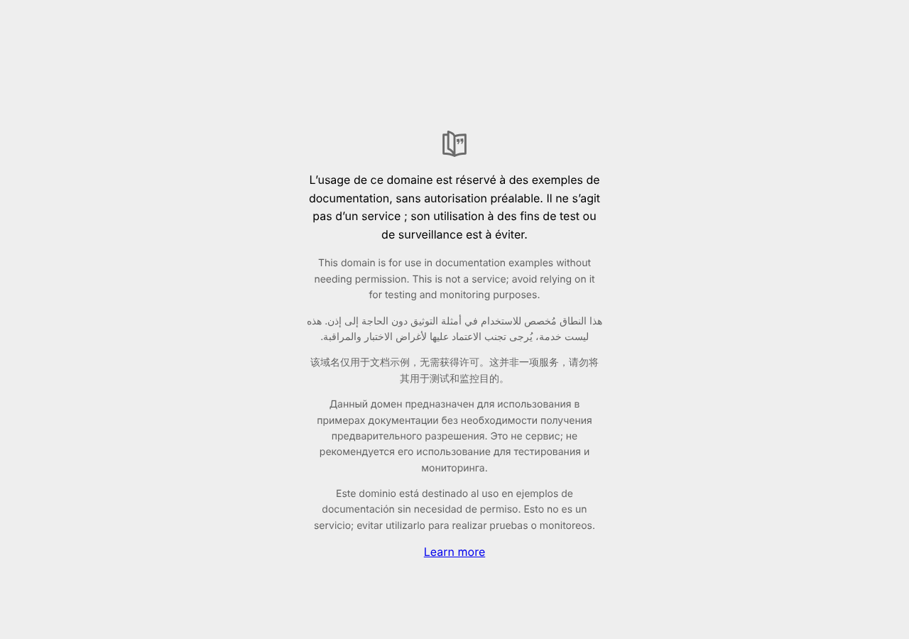

# BUG-008 — Redirection ouverte après connexion (paramètre `next`)

| Champ | Valeur |
|---|---|
| Sévérité | **Majeure** |
| Priorité | **P2** |
| Canal | UI |
| Module | Authentification / Sécurité |
| Statut | Ouvert |
| Détecté le | 13/10/2026 |
| Détecté par | Quality audit |
| Cas de test liés | TC-ERR-06 |
| Environnement | QuickOrder V3.1 · base initialisée par `python seed.py` · http://127.0.0.1:5000 · Chromium (Playwright) · Python 3.13 · SQLite |

## Contexte

Après connexion, l'application redirige vers la valeur du paramètre `next` sans la valider.

## Préconditions

Visiteur non connecté ; compte alice@example.com / Password123!.

## Étapes pour reproduire

1. Ouvrir /login?next=https://example.org.
2. Se connecter avec alice@example.com / Password123!.

## Résultat attendu

Redirection vers une page interne de QuickOrder (l'accueil).

## Résultat obtenu

Redirection (302, en-tête `Location: https://example.org`) : le navigateur quitte QuickOrder pour le site externe après une authentification légitime.

## Preuves

**Rejouer en ligne de commande (commande de rejeu)**

```bash
curl -s -i -X POST -d 'email=alice@example.com&password=Password123!' 'http://127.0.0.1:5000/login?next=https://example.org' | head -5
```

### Preuves du cas TC-ERR-06 (Fail)



Trace `TC-ERR-06.txt` :

```text
Navigations : ['http://127.0.0.1:5000/login?next=https://example.org', 'https://example.org/']
URL finale : https://example.org/
$ curl -i -X POST -d 'email=alice@example.com&password=…' 'http://127.0.0.1:5000/login?next=https://example.org'
HTTP 302 | Location: https://example.org
```

### Rejeu automatique (curl)

Le script `docs/automation/reproduce_bugs.sh` rejoue ce bug et affiche `REPRODUIT` ou `NON REPRODUIT` ; sortie conservée dans [`reproduction-curl.txt`](../evidence/reproduction-curl.txt).

## Analyse

- **Cause probable** : app/routes/auth.py : `return redirect(request.args.get("next") or url_for("main.index"))` sans vérifier que l'URL est locale.
- **Impact** : Un lien piégé peut renvoyer l'utilisateur vers un faux site (hameçonnage).

## Suggestion de correction

N'accepter que les chemins relatifs internes (par exemple vérifier `urlparse(next).netloc == ""`).
